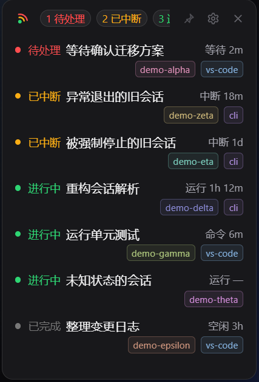

# Pinglet

> 轻量常驻的 Claude Code 会话状态看板。

<p align="center">
  
</p>


Pinglet 把本机所有活跃的 Claude Code 交互式会话聚合成一个小巧的置顶窗口，用「待处理 / 已中断 / 进行中 / 已完成」四种状态告诉你哪个会话正在等你。它只读取本地会话状态文件与 transcript 标题记录，不联网、不调用 Claude API，也不修改任何 Claude 配置。


## 功能

- **四态看板**：待处理置顶，已中断独立标色；等得越久越靠前，异常会话一眼可见。
- **状态提醒**：待处理 / 已中断突变时触发呼吸灯、音效与窗口抖动；进行中 → 已完成有轻量完成提示；窗口隐藏时会在屏幕右下角弹出应用内通知卡片。
- **行持续动效**：待处理 / 已中断行有背景呼吸与状态灯光环，进行中行底部有循环流光；两个动效可分别关闭，已完成行不打扰。
- **托盘状态**：警示 / 进行中 / 空闲三态由图标自身呼吸 / 闪烁表达；托盘使用深绿描边的专用图标，隐藏期间出现新告警会闪烁，tooltip 汇总各状态数量。
- **一键回到会话**：双击会话行（或按 Enter）激活对应的 VSCode 窗口或 Git Bash 终端；只激活已打开窗口，不会新开 VSCode。
- **临时隐藏**：右键已完成会话可将其从面板临时移除，状态变化或重启后自动恢复。
- **常驻但不打扰**：窗口置顶、无边框、高度随内容自适应，拖到屏幕边缘会自动吸附；记住窗口位置，重复启动只保留一个实例。
- **按需定制**：暗 / 亮 / 自动主题、三档字号、面板透明度、提醒方式、面板行持续动效、应用内免打扰、通知弹窗、开机自启与全局快捷键（默认 `Alt+Shift+P`）。
- **只读与隐私**：只解析白名单字段；transcript 只读标题记录，不读取消息正文。

## 下载与安装

前往 [Releases](https://github.com/fongzhizhi/pinglet/releases) 下载最新安装包；若尚无发布版本，可按[构建说明](docs/build.md)自行打包。

- 系统要求：Windows 10 / 11（需要 WebView2 Runtime，Windows 11 已内置）
- 安装包：`Pinglet_<version>_x64-setup.exe`
- 便携版：从 Release 下载 `Pinglet_<version>_x64-portable.zip`，解压后直接运行；也可自行构建 `src-tauri/target/release/pinglet.exe`
- Release 同时提供 `SHA256SUMS.txt`，可用于校验下载文件的完整性

首次启动后窗口出现在屏幕右上角，默认始终置顶。

## 使用

- 悬停会话行约 1.5 秒，查看完整路径、状态、入口、进程与会话 ID。
- 双击或按 Enter 激活会话：VSCode 会话会切到对应窗口；CLI 会话会聚焦其所在的 VSCode 集成终端或 Git Bash 窗口。
- 顶栏图钉切换「拖动 / 固定」模式，齿轮打开设置；关闭按钮按设置直接退出或最小化到托盘。
- 托盘图标使用深绿描边的专用版本显示看板状态：进行中整体呼吸，隐藏期间出现新告警且未读时隐藏 / 显示闪烁，空闲为静态图标。右键提供「显示 / 鼠标穿透 / 设置 / 退出」。开启鼠标穿透后，用全局快捷键或托盘左键恢复。
- 更完整的交互、窗口行为与已知限制见 [使用说明](docs/usage.md)。

## 设置

设置只保存在本机 WebView 的 `localStorage`，不会写入 Claude 配置。

| 项目 | 默认值 |
| --- | --- |
| 主题 | 自动（可选暗色 / 亮色） |
| 字号 | 标准（14px） |
| 面板透明度 | 0%（完全不透明） |
| 提醒 | 呼吸灯 / 音效 / 窗口抖动全开 |
| 行持续动效 | 异常行呼吸灯 / 进行中行流光开启 |
| 通知弹窗 | 开启 |
| 应用内免打扰 | 关闭（不受 Windows 系统「请勿打扰」影响） |
| 关闭行为 | 最小化到托盘 |
| 开机自启 | 关闭 |
| 全局快捷键 | `Alt+Shift+P` |
| 鼠标穿透 | 关闭 |

设置面板底部提供「恢复默认」，会清空全部本地设置并刷新页面。

## 数据与隐私

- 只读取 `%USERPROFILE%\.claude\sessions\*.json` 和 `~/.claude/projects/*/<sessionId>.jsonl` 中的标题记录。
- 会话文件只解析白名单字段：`pid` / `cwd` / `name` / `nameSource` / `sessionId` / `kind` / `entrypoint` / `status` / `statusUpdatedAt` / `updatedAt`。
- transcript 只读头尾窗口里的 `custom-title` / `ai-title`，不读取消息正文、不展示 Prompt、不写回任意 Claude 文件。
- 错误信息只包含文件名与失败原因，不输出 JSON 内容；应用不联网、不调用 Claude API。
- 自动主题只在内存中读取窗口下方少量屏幕像素的亮度，不截图、不落盘、不上传。

## 开发

```bash
npm install
npm run dev:desktop  # 桌面开发（前端热更新 + Tauri 窗口）
npm run dev:web      # 浏览器预览 UI（http://localhost:1420）
npm test             # Vitest 单元测试
npm run lint         # ESLint
npm run format       # Prettier 格式化
npm run build        # 类型检查 + 前端构建
npm run build:nsis   # 打包 NSIS 安装包
cargo test --manifest-path src-tauri/Cargo.toml   # Rust 单元测试
```

前置依赖：Rust（MSVC 工具链）、Visual Studio Build Tools 的 C++ 工作负载 + Windows SDK、WebView2 Runtime。打包、图标生成与常见问题见 [构建说明](docs/build.md)。推送到 `master` 或提交 PR 会触发 `.github/workflows/ci.yml`；推送 `v*` 标签会生成草稿 Release。

```text
src/                 前端：轮询、四态看板、设置面板、Tauri IPC 封装
src-tauri/src/       Rust：会话读取、标题解析、窗口 / 托盘 / 快捷键 / 激活会话
assets/app-icon.svg  应用图标唯一源文件
docs/                使用说明、构建说明与设计文档
```

## 文档

- [使用说明](docs/usage.md)：界面、交互、设置与窗口行为
- [构建与打包](docs/build.md)：环境准备、NSIS 打包、图标生成
- [设计文档索引](docs/plans/README.md)：各版本设计稿、实现状态与验收记录
- [变更日志](CHANGELOG.md)：版本变更与发布说明
- [会话标题数据源说明](docs/session-title-source.md)
- [开发约定](CLAUDE.md)

## 已知限制

- 部分版本的 Claude Code VS Code 扩展以非交互模式启动，不写入 `%USERPROFILE%\.claude\sessions\` 注册文件，其会话不会出现在看板上；请升级扩展，或改用集成终端运行 `claude`。
- 不读取消息正文，因此悬浮提示不展示 Prompt 内容；无标题的新会话回退显示目录名。
- CLI 会话仅支持激活 VSCode 集成终端或 Git Bash 窗口；Windows Terminal 等终端未支持。
- 鼠标穿透开启后窗口不接收点击，需通过全局快捷键或托盘菜单恢复。
- 通知弹窗由 Pinglet 自绘，显示在主屏工作区右下角并于约 5 秒后自动隐藏，点击卡片可唤起主窗口；不受 Windows 通知开关与「请勿打扰」影响。Windows 也可能把托盘图标收进溢出区。
- 当前安装包未做代码签名，首次运行可能触发 Windows SmartScreen 提示。

## License

[MIT](LICENSE)
